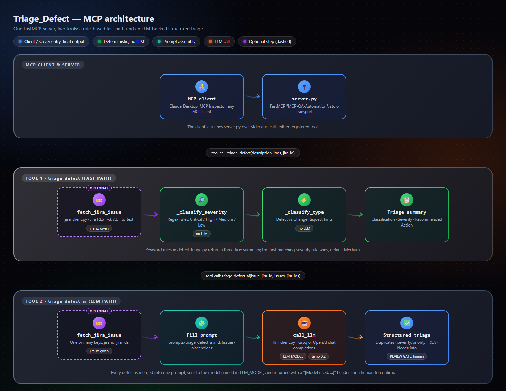
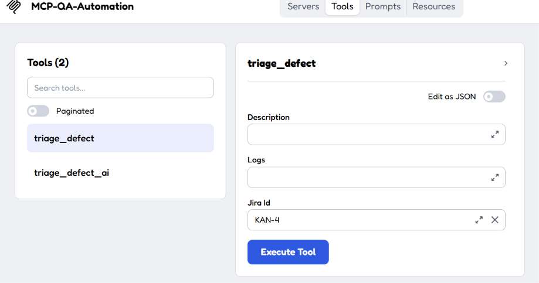
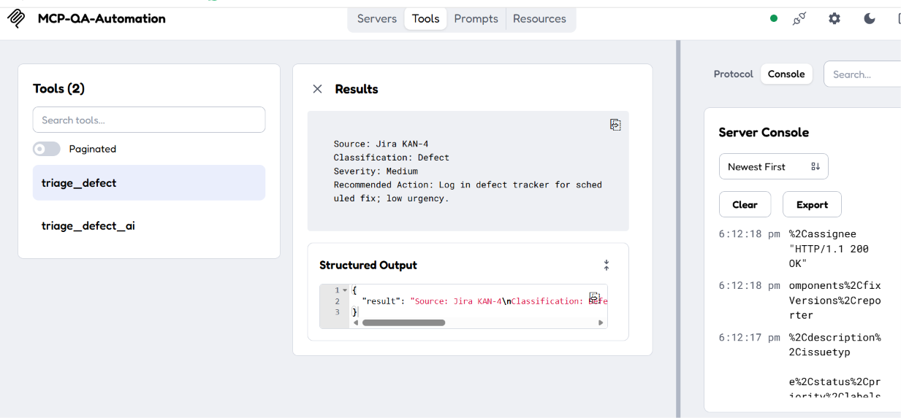
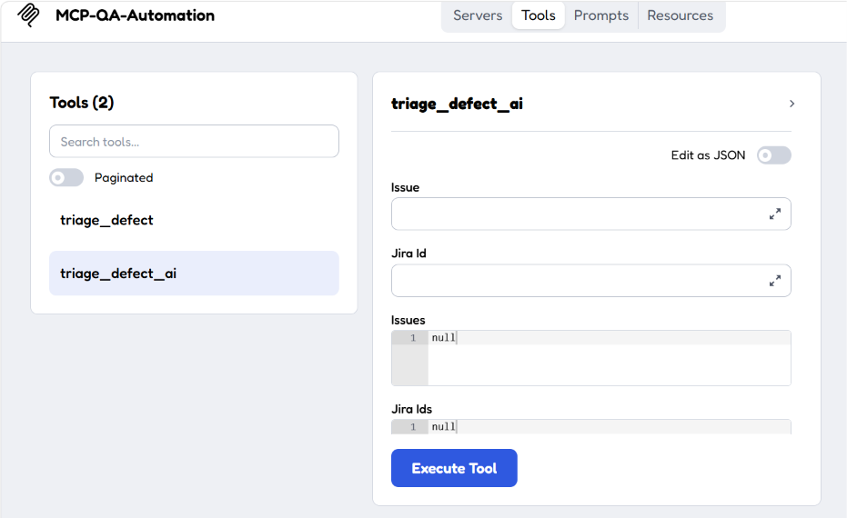
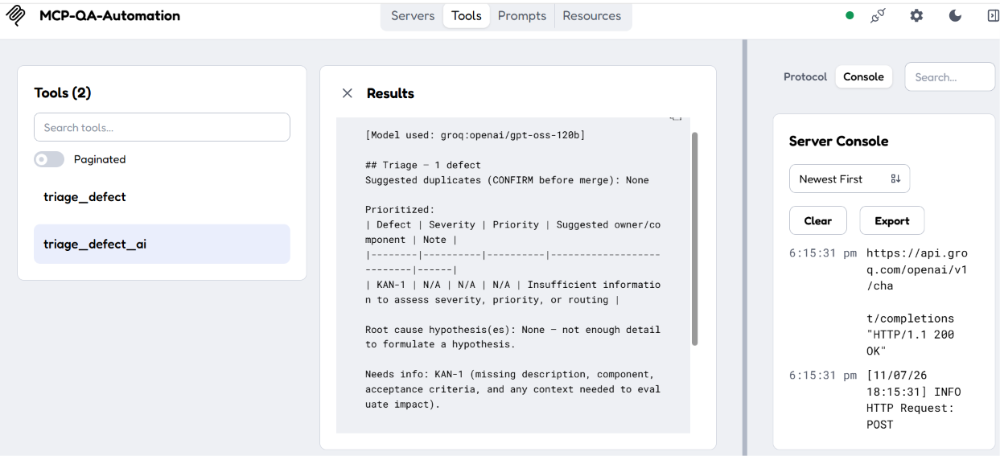

# Triage_Defect

> An MCP server that triages defects with keyword rules or an LLM, from raw text or Jira issue keys.


## What It Does

Paste a defect description, logs, or a Jira key into any MCP client (Claude Desktop, MCP Inspector) and get back a severity, a defect-vs-change-request call, and a routing recommendation. Two tools cover two needs: `triage_defect` applies fixed keyword rules and answers instantly with no LLM, while `triage_defect_ai` sends one or many defects to a Groq or OpenAI model and returns a structured triage table with duplicate suggestions, root-cause hypotheses, and a "Needs info" list. No prompt engineering is required — the triage prompt ships in `tools/prompts/triage_defect_ai.md`.

---

## Architecture



- **MCP client and server:** the client starts `server.py` over stdio and calls whichever tool it needs.
- **Tool 1, `triage_defect`:** optional Jira fetch, then two regex classifiers, then a three-line summary. No network call except Jira.
- **Tool 2, `triage_defect_ai`:** optional Jira fetches, prompt assembly, one LLM call, and a structured result that a human confirms.

<details>
<summary>Text-only version</summary>

```
MCP client (Claude Desktop / MCP Inspector)
        |  stdio
        v
server.py  (FastMCP "MCP-QA-Automation")
   |                                   |
   | triage_defect                     | triage_defect_ai
   v                                   v
[jira_id?] fetch_jira_issue        [jira_id / jira_ids?] fetch_jira_issue
   v                                   v
_classify_severity (regex)         fill prompts/triage_defect_ai.md
   v                                   v
_classify_type (regex)             call_llm -> Groq or OpenAI
   v                                   v
3-line summary                     structured triage + "Needs info"
                                   (human confirms before acting)
```
</details>

### Ports

`server.py` uses the stdio transport, so it listens on no port. The MCP Inspector (`mcp dev server.py`) opens its own local ports:

| Service | Port | Notes |
|---|---|---|
| MCP Inspector web UI | 6274 | Default; the Inspector prints the full URL with a token |
| Inspector sandbox | 6275 | MCP Apps sandbox; falls back to a free port if taken |
| Inspector app origin | 6278 | Falls back to a free port if taken |

### How a request flows

1. The MCP client launches `python server.py` and speaks MCP over stdin/stdout.
2. `server.py` registers `triage_defect` and `triage_defect_ai` with FastMCP.
3. If a Jira key is passed, `fetch_jira_issue` calls the Jira REST API and flattens the issue into plain text.
4. `triage_defect` classifies that text with regex rules; `triage_defect_ai` fills the prompt template and calls the LLM.
5. The tool returns a plain-text result to the client.

---

## AI Integration

Only `triage_defect_ai` uses an LLM. `triage_defect` is pure regex and never leaves your machine (except for the optional Jira fetch).

**Why a direct API call.** There is no orchestration framework. `llm_client.py` posts straight to an OpenAI-compatible chat-completions endpoint with `httpx`, which keeps the dependency list to four packages and works with both providers through one code path.

**Why Groq or OpenAI.** Both expose the same `/chat/completions` request shape. Groq has a free tier and fast inference, which suits trying the tool out; OpenAI is the alternative if you already have a key. The provider is chosen by `LLM_MODEL`.

**Where the call happens.** `tools/llm_client.py:67-79`, inside `call_llm()`. It is reached from `_run_triage_ai()` at `tools/defect_triage.py:25`.

**Request body** (from `tools/llm_client.py`):

```python
# llm_client.py:67-73
httpx.post(
    url,
    json={
        "model": model,
        "messages": [{"role": "user", "content": prompt}],
        "temperature": temperature,   # default 0.2
    },
```

```
URL: https://api.groq.com/openai/v1/chat/completions    (provider "groq")
     https://api.openai.com/v1/chat/completions         (provider "openai")
Header: Authorization: Bearer <GROQ_API_KEY or OPENAI_API_KEY>
Timeout: 60 seconds
```

**Choosing the provider.** `_resolve_provider_and_model()` (`llm_client.py:23-32`) reads `LLM_MODEL`:

| `LLM_MODEL` value | Provider | Model |
|---|---|---|
| `groq:openai/gpt-oss-120b` | groq | `openai/gpt-oss-120b` |
| `openai:gpt-4o-mini` | openai | `gpt-4o-mini` |
| `gpt-4o-mini` (no prefix) | groq if `GROQ_API_KEY` is set, otherwise openai | as given |
| empty | none — returns an error | — |

**Session or context isolation.** There is none. Every call sends one fresh single-message request, so nothing carries over between calls. All defects in a batch go into the same prompt, which is how duplicates are found.

**Where the prompt lives.** `tools/prompts/triage_defect_ai.md`. `_run_triage_ai()` (`defect_triage.py:20-25`) joins all defect entries and replaces the `{issues}` placeholder. The prompt tells the model to use only the content given, to flag missing information under "Needs info" instead of guessing, and to propose rather than reassign or close anything.

**Response parsing.** There is no parsing. The model's text is returned as-is with a header line:

```
[Model used: groq:openai/gpt-oss-120b]

<model output>
```

`eval/run_eval.py` is the only place that parses the output; it uses regex to pull the first severity word, the first priority word, and the `Needs info:` line.

**Output categories.**

| Field | Allowed values |
|---|---|
| Severity | Blocker, Critical, Major, Minor, Trivial |
| Priority | P0, P1, P2, P3, P4 |
| Duplicates | Groups of defects with the shared symptom, or "None" |

**Swapping the LLM.** Change `LLM_MODEL` and the matching API key in `.env`; no code change is needed for any OpenAI-compatible provider that is already `groq` or `openai`.

**Keyword path categories.** `triage_defect` uses different labels: severity Critical / High / Medium / Low (default Medium) and classification Defect / Change Request (default Defect). Rules are in `SEVERITY_RULES`, `CHANGE_REQUEST_HINTS`, and `DEFECT_HINTS` in `tools/defect_triage.py:28-43`.

---

## Prerequisites

| Requirement | Version | Notes |
|---|---|---|
| Python | 3.10 or newer | The code uses `list[str] \| None` type syntax |
| pip | any recent | Installs `requirements.txt` |
| Node.js / npx | any recent LTS | Only for `mcp dev`, which downloads the MCP Inspector on first run |
| LLM account | — | Groq or OpenAI API key; only needed for `triage_defect_ai` |
| Jira Cloud account | — | Only needed when you pass `jira_id` / `jira_ids` |

---

## Installation

```bash
cd Triage_Defect
python -m venv venv
venv\Scripts\activate          # macOS/Linux: source venv/bin/activate
pip install -r requirements.txt
copy .env.example .env         # macOS/Linux: cp .env.example .env
```

Then edit `.env` (see Configuration).

---

## Configuration

`.env` template (from `.env.example`):

```env
# Jira (only needed when passing jira_id / jira_ids)
JIRA_URL=https://your-domain.atlassian.net
JIRA_EMAIL=
JIRA_API_TOKEN=

# LLM used by triage_defect_ai, e.g. groq:openai/gpt-oss-120b or openai:gpt-4o-mini
LLM_MODEL=
GROQ_API_KEY=
OPENAI_API_KEY=
```

| Variable | What it is | How to get the value |
|---|---|---|
| `JIRA_URL` | Base URL of your Jira Cloud site | Copy from your browser, for example `https://your-domain.atlassian.net` |
| `JIRA_EMAIL` | Email of the Jira account that owns the token | The email you log in to Atlassian with |
| `JIRA_API_TOKEN` | Jira API token (`JIRA_TOKEN` is also accepted) | https://id.atlassian.com/manage-profile/security/api-tokens |
| `LLM_MODEL` | `provider:model` string | See the table in AI Integration |
| `GROQ_API_KEY` | Groq API key | Create one in the Groq console |
| `OPENAI_API_KEY` | OpenAI API key | Create one in the OpenAI dashboard |

`.env` is listed in `.gitignore`; never commit it.

---

## AI Service Setup

1. **Pick a provider.** Create an account with Groq or OpenAI and generate an API key.
2. **Set the model.** In `.env`, set `LLM_MODEL` (for example `groq:openai/gpt-oss-120b`) and the matching `GROQ_API_KEY` or `OPENAI_API_KEY`.
3. **Create a Jira API token (optional).** Open https://id.atlassian.com/manage-profile/security/api-tokens, create a token, and put it in `JIRA_API_TOKEN` together with `JIRA_EMAIL` and `JIRA_URL`.
4. **Check Jira access.** The Jira host must be reachable from the machine running the server. A timeout returns `Error: could not reach Jira (...)`; a wrong token returns `Error: Jira returned 401 ...`.

---

## Running Locally

```bash
python server.py          # stdio server, for MCP clients to launch
mcp dev server.py         # starts the MCP Inspector in your browser
```

`mcp dev` starts the Inspector web UI on port 6274 and prints a URL with an access token, for example `http://127.0.0.1:6274?MCP_INSPECTOR_API_TOKEN=<token>`. Open that URL, click **Connect**, then use the **Tools** tab.

To use the server from Claude Desktop, add it to the MCP servers configuration with the command `python` and the argument `<full path>\server.py`.

---

## Using the App

1. Start the Inspector with `mcp dev server.py` and open the printed URL.
2. Click the **Connect** switch, then open the **Tools** tab. You should see `triage_defect` and `triage_defect_ai`.
3. Pick `triage_defect` and fill in `Description`, `Logs`, or `Jira Id` (for example `The app crashes and users cannot log in at all.`, or a Jira key).

   

   *The `triage_defect` form in the MCP Inspector, with the Jira Id field filled in.*
4. Click **Execute Tool** and read the result: Source, Classification, Severity, Recommended Action.

   

   *The keyword-based result for a Jira issue. The Server Console on the right shows the Jira API requests the server made.*
5. Pick `triage_defect_ai`. Use `Issue` for one defect's text, `Jira Id` for one key, `Issues` for a list of texts, or `Jira Ids` for a list of keys. Leave unused list fields as `null`.

   

   *The `triage_defect_ai` form with its four inputs.*
6. Click **Execute Tool**. Review the structured table and confirm any suggested duplicates and "Needs info" items yourself; the tool only proposes.

   

   *The LLM result for a Jira issue with no description: the model returns N/A ratings and flags the missing fields under "Needs info" instead of guessing. The console shows the call to the Groq API.*

---

## Input Format

Every argument is optional, but each tool needs at least one of its text or Jira inputs.

**`triage_defect(description, logs, jira_id)`**

```json
{
  "description": "Payment fails when the user applies a discount coupon.",
  "logs": "HTTP 500 from /api/checkout",
  "jira_id": "QA-123"
}
```

| Argument | Type | Meaning |
|---|---|---|
| `description` | string | Issue text as reported. Appended after the Jira text if both are given |
| `logs` | string | Optional error log or stack trace; included in keyword matching |
| `jira_id` | string | Jira key such as `QA-123`; fetched from Jira |

**`triage_defect_ai(issue, jira_id, issues, jira_ids)`**

```json
{
  "issue": "Checkout button does nothing when clicked on Safari 17, macOS. Blocks all purchases on Safari.",
  "jira_ids": ["QA-123", "QA-124"],
  "issues": ["Search results page shows a typo: 'Reslts' instead of 'Results'."]
}
```

| Argument | Type | Meaning |
|---|---|---|
| `issue` | string | One defect's raw text |
| `jira_id` | string | One Jira key |
| `issues` | list of strings | Raw text for several defects |
| `jira_ids` | list of strings | Several Jira keys |

Any combination is merged into one batch. With two or more defects, the model also looks for duplicates.

**Tip:** include repro steps, environment (browser, OS, version), and observed versus expected behaviour. Vague input such as "The app is broken." is flagged under "Needs info" instead of getting a confident rating.

---

## Output Format

**`triage_defect`**

```
Source: Jira QA-123
Classification: Defect
Severity: High
Recommended Action: Route to dev team for next release; verify no workaround exists.
```

| Field | Meaning |
|---|---|
| Source | Present only when `jira_id` was given |
| Classification | `Defect` or `Change Request` |
| Severity | `Critical`, `High`, `Medium`, or `Low` |
| Recommended Action | One-line routing based on classification and severity |

**`triage_defect_ai`** returns the shape defined in `tools/prompts/triage_defect_ai.md`:

```
[Model used: groq:openai/gpt-oss-120b]

## Triage — <n defects>
Suggested duplicates (CONFIRM before merge): <groups, or "None">
Prioritized:
  | Defect | Severity | Priority | Suggested owner/component | Note |
Root cause hypothesis(es): ...
Needs info: <defect> (<missing field>), or "None"
```

| Field | Meaning |
|---|---|
| Suggested duplicates | Defects the model thinks describe the same issue; "None" for a single defect |
| Severity / Priority | Blocker–Trivial and P0–P4 |
| Suggested owner/component | Likely owning team, or the model says it can't tell |
| Root cause hypothesis(es) | Best guess from the text given; no invented logs |
| Needs info | Defects missing repro steps, environment, or evidence |

Errors come back as plain strings starting with `Error:`, for example `Error: description or jira_id must be provided.`

---

## Sample Files

### Evaluation cases

`eval/cases.json` holds the labeled inputs for `python eval/run_eval.py`.

| Case id | What it covers | Expected severity | Expected priority |
|---|---|---|---|
| `critical-auth-bypass` | Session token not invalidated after password change | Blocker, Critical | P0, P1 |
| `checkout-crash-safari` | Checkout button dead on Safari 17 | Blocker, Critical | P0, P1 |
| `minor-typo` | "Reslts" typo, no functional impact | Minor, Trivial | P3, P4 |
| `slow-report-load` | Monthly report takes about 8 seconds | Major, Minor | P2, P3 |
| `vague-missing-info` | "The app is broken." — must be flagged under Needs info | none | none |

### Screenshots

| File | What it shows |
|---|---|
| `ScreenShots/Architecture_Diagram.png` | The client, server, and both tool pipelines, color-coded by step type |
| `ScreenShots/triage_defect_UI.png` | Inspector Tools tab with `triage_defect` selected and `Jira Id` set to `KAN-4`; also shows the `Description` and `Logs` fields |
| `ScreenShots/triage_defect_result.png` | Result for `KAN-4`: Source, Classification Defect, Severity Medium, Recommended Action, plus the Structured Output JSON and Jira request lines in the Server Console |
| `ScreenShots/triage_defect_ai_UI.png` | Inspector Tools tab with `triage_defect_ai` selected, showing `Issue`, `Jira Id`, `Issues`, and `Jira Ids` |
| `ScreenShots/triage_defect_ai_result.png` | Result for `KAN-1` from `groq:openai/gpt-oss-120b`: "Needs info" flagged because the issue had no description; the console shows the 200 response from the Groq API |

### Tests

`tests/test_tools.py` has six unit tests (critical, high, and low severity, change request, and empty input for both tools). They need no network.

---

## API Reference

This project exposes MCP tools, not an HTTP API. To call a tool without an MCP client, import it directly:

```bash
python -c "from tools.defect_triage import triage_defect; print(triage_defect('The app crashes and users cannot log in at all.'))"
```

Success output:

```
Classification: Defect
Severity: Critical
Recommended Action: Escalate immediately to dev team; treat as production-blocking.
```

Run the tests and the eval:

```bash
pytest tests/ -v          # 6 unit tests, no network
python eval/run_eval.py   # needs an LLM key; prints PASS/FAIL per case
```

The eval is a prompt sanity check, not a strict gate; LLM output varies, so read the mismatches rather than treating one failure as a bug.

No Postman collection is included.

---

## Project Structure

```
Triage_Defect/
├── server.py                      # FastMCP server; registers the two tools
├── requirements.txt               # mcp, pytest, python-dotenv, httpx
├── .env.example                   # Template for Jira and LLM settings
├── .gitignore                     # Ignores .env, __pycache__, *.pyc
├── README.md                      # This file
├── tools/
│   ├── __init__.py                # Package marker
│   ├── defect_triage.py           # triage_defect, triage_defect_ai, keyword rules
│   ├── jira_client.py             # Fetches a Jira issue and flattens it to text
│   ├── llm_client.py              # Groq/OpenAI chat-completions call
│   └── prompts/
│       └── triage_defect_ai.md    # Prompt template with {issues} placeholder
├── tests/
│   └── test_tools.py              # Six unit tests, no network
├── eval/
│   ├── cases.json                 # Labeled defects with expected severity/priority
│   └── run_eval.py                # Runs cases through triage_defect_ai
└── ScreenShots/
    ├── Architecture_Diagram.png   # Architecture diagram used in this README
    ├── triage_defect_UI.png       # Inspector form for triage_defect
    ├── triage_defect_result.png   # triage_defect output for a Jira issue
    ├── triage_defect_ai_UI.png    # Inspector form for triage_defect_ai
    └── triage_defect_ai_result.png # triage_defect_ai output for a Jira issue
```

`tools/defect_triage.py` also defines `triage_defect_prompt()`, which builds a prompt without calling a model. `server.py` does not register it, so MCP clients cannot call it.

---

## Team Adoption Checklist

- [ ] Install Python 3.10 or newer and confirm with `python --version`.
- [ ] Clone the repo and `cd Triage_Defect`.
- [ ] Create and activate a virtual environment (`python -m venv venv`).
- [ ] Run `pip install -r requirements.txt`.
- [ ] Run `pytest tests/ -v` and confirm 6 tests pass.
- [ ] Copy `.env.example` to `.env`.
- [ ] Create a Groq or OpenAI API key and set `LLM_MODEL` plus the matching key in `.env`.
- [ ] (Optional) Create a Jira API token and set `JIRA_URL`, `JIRA_EMAIL`, and `JIRA_API_TOKEN`.
- [ ] Confirm `.env` is not tracked by git (`git status` should not list it).
- [ ] Install Node.js, then run `mcp dev server.py` and open the printed Inspector URL.
- [ ] Click **Connect** and **List Tools**; confirm both tools appear.
- [ ] Run `triage_defect` with a sample description and check the three-line result.
- [ ] Run `triage_defect_ai` with one defect and confirm the output starts with `[Model used: ...]`.
- [ ] Run `triage_defect_ai` with two similar defects and check the "Suggested duplicates" line.
- [ ] Run `python eval/run_eval.py` and read any FAIL lines.
- [ ] Add the server to your MCP client (for example Claude Desktop) using `python` and the full path to `server.py`.
- [ ] Try a real Jira key through either tool, once your Jira host is reachable.

---

## Related Modules

This project lives in the `MCP_QA_Automation` folder. No sibling modules were found next to it.
